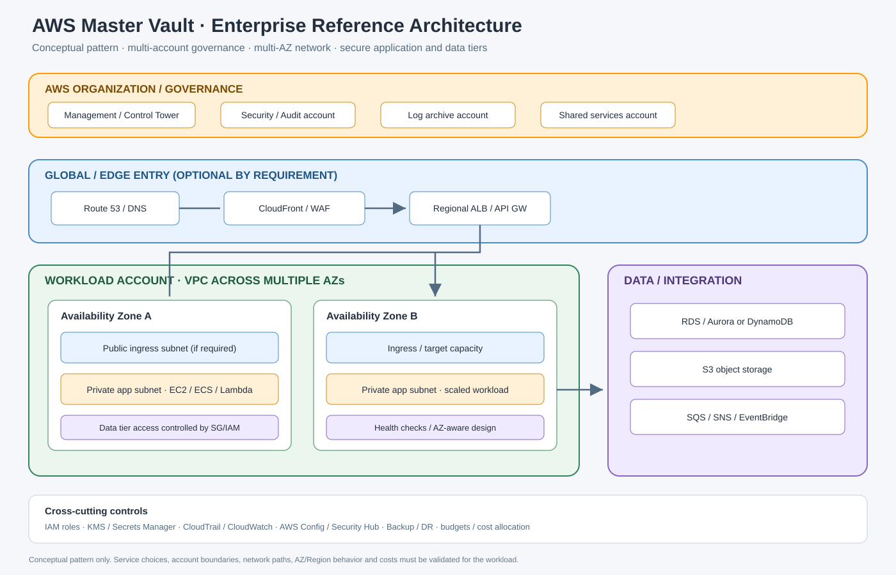

# AWS Enterprise Reference Architecture

> A logical reference pattern for learning how common AWS services fit together. This is not a universal deployment; choose components based on workload requirements, data classification, RTO/RPO, region support and budget.

[← Learning tracker](README.md) · [Portfolio projects](PORTFOLIO-PROJECTS.md)

[Editable diagrams.net source](architecture.drawio)

## 1. Account and governance layer

Use AWS Organizations and a deliberate multi-account strategy to separate security/audit, log archive, shared networking, development, test and production responsibilities as appropriate. AWS Control Tower can help establish a governed landing zone. Service Control Policies are permission guardrails; they do not grant permissions. Choose organization structure and policy inheritance intentionally.

## 2. Identity and security

Use federation/IAM Identity Center for workforce access where appropriate, IAM roles for workloads, temporary credentials, least-privilege policies and explicit cross-account trust. Use KMS for supported encryption key management, Secrets Manager for application secrets, CloudTrail for API audit, and selected security services for findings and posture. Apply resource policies and network controls as separate layers.

## 3. Network and ingress

A common regional pattern uses a VPC across multiple Availability Zones, public subnets for required internet-facing ingress, private application subnets, and isolated data subnets where appropriate. Use route tables, Security Groups and Network ACLs deliberately. NAT Gateways are for eligible outbound IPv4 flows and can create material ongoing cost. VPC endpoints/PrivateLink require correct service support, endpoint policy, DNS and routing.

## 4. Request path

A typical web flow might be Route 53 → CloudFront and/or AWS WAF → ALB → application compute (EC2, ECS/Fargate or another appropriate platform) → data tier such as RDS/Aurora or DynamoDB. These services are alternatives or optional layers, not a mandatory chain. Use API Gateway + Lambda for suitable API/serverless workloads. Choose edge and regional ingress based on latency, security, routing and operational requirements.

## 5. Data and event flow

S3 can store objects; supported S3 events can trigger Lambda or EventBridge-based workflows. SQS can buffer work, SNS can fan out messages, and Step Functions can coordinate multi-step workflows. Select RDS/Aurora for relational patterns and DynamoDB for access-pattern-driven key-value/document workloads. Define idempotency, retry, dead-letter, retention and data-protection behavior.

## 6. Observability and operations

Collect appropriate CloudWatch metrics, logs, alarms and dashboards; use CloudTrail for API activity and AWS Config for configuration history/compliance evaluation. Define alert ownership, log retention, operational runbooks, service quotas and escalation. Separate security telemetry from application SLO signals where needed.

## 7. Availability and disaster recovery

Multi-AZ, multi-Region, backup and replication solve different problems. Set RTO/RPO with business owners. Document which failures the design must tolerate, data consistency implications, DNS/traffic failover, identity/network dependencies, restore permissions and the recovery test cadence. Do not claim resilience until failover and restoration have been exercised.

## 8. Delivery and cost

Use CloudFormation, CDK or Terraform to version infrastructure. Review plans/templates, protect state and deployment credentials, use staged environments, add health validation and rollback. Review compute uptime, storage, requests, NAT/egress, load balancers, logs, backups, databases and AI inference costs. Budgets and alarms notify; they are not hard spend caps.

## 9. Validation checklist

- [ ] Account, Region, quotas and supported features verified
- [ ] IAM trust and permission policies reviewed
- [ ] VPC/subnet/routes/security groups/DNS validated
- [ ] Encryption, secrets and audit logging configured
- [ ] Health checks, metrics, logs and actionable alarms tested
- [ ] Backup/restore and failure paths exercised
- [ ] Cost assumptions and budget notifications reviewed
- [ ] Deployment rollback and teardown tested

## Official starting points

- [AWS Well-Architected Framework](https://docs.aws.amazon.com/wellarchitected/latest/framework/welcome.html)
- [AWS Architecture Center](https://aws.amazon.com/architecture/)
- [AWS multi-account strategy](https://docs.aws.amazon.com/organizations/latest/userguide/orgs_getting-started_concepts.html)
- [AWS Security best practices](https://docs.aws.amazon.com/security/)
- [AWS pricing](https://aws.amazon.com/pricing/)
