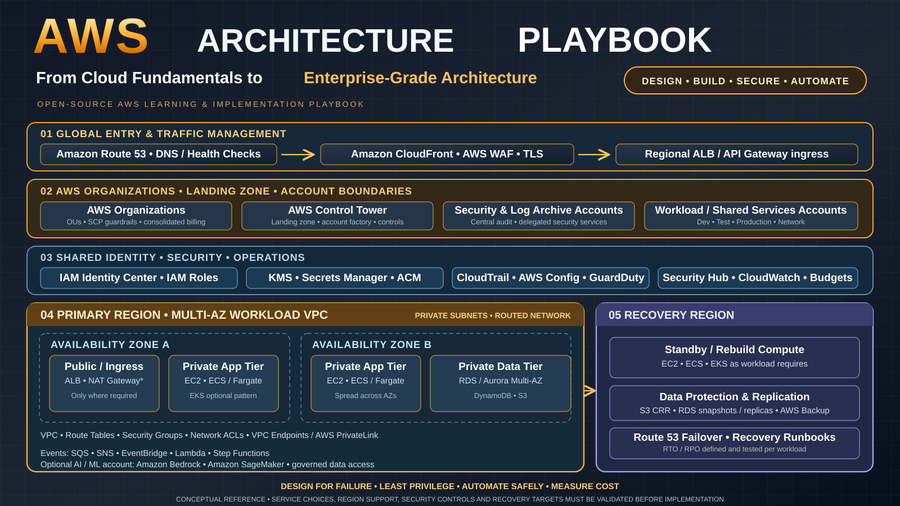
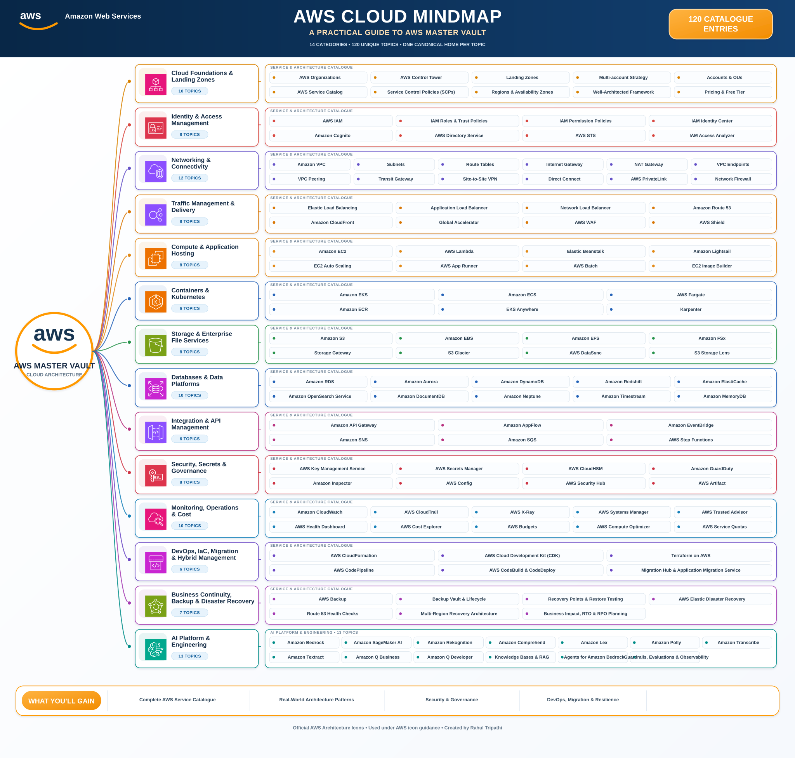
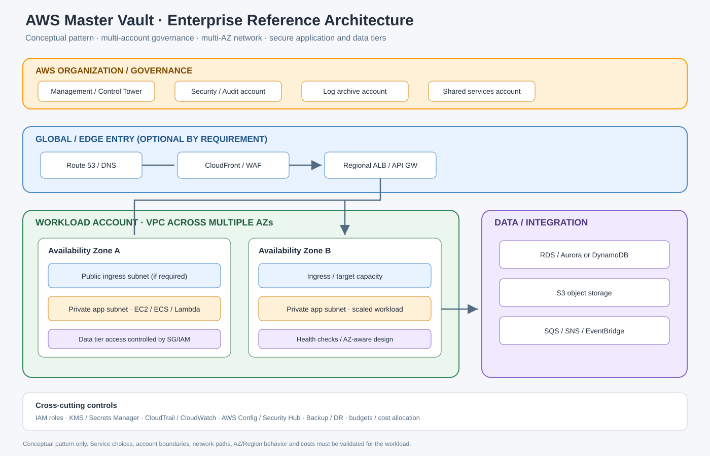

# Cloud Architecture Playbook

> **AWS Edition** — From Cloud Fundamentals to Enterprise-Grade Architecture. An open-source Solution Architect learning portal with service guides, reference architecture, diagrams and hands-on implementation projects.

## AWS component catalogue mind map

The master visual index is available as a **self-contained SVG** and an **editable diagrams.net source**. It uses official AWS Architecture service icons for the domain anchors and full service names instead of alphabet-only markers.

  

- [Open the AWS component mind map (SVG)](assets/aws-component-mindmap.svg)
- [Edit the mind map in diagrams.net (draw.io)](AWS-COMPONENT-MINDMAP.drawio)
- [Browse the machine-readable catalogue](catalog.json)

| 
📚 Learning tracker
 | 
🏗️ End-to-end design
 | 
🗺️ Diagram library
 |
|---|---|---|
| Work through the catalogue by category. Each topic links to its guide. | Explore how governance, identity, networking, workloads, data, security and operations fit together. | Preview architecture diagrams and open editable draw.io sources. |
| [**Track topics below ↓**](#your-aws-learning-tracker) | [**Open reference design →**](AWS-ENTERPRISE-REFERENCE-ARCHITECTURE.md) | [**Open visual library →**](VISUAL-DIAGRAMS.md) |

## Your AWS learning tracker

Track progress across the seven catalogue milestones and all 70 learning topics in the interactive tracker.

**[Open the AWS learning tracker →](https://tripathies.github.io/aws-master-vault/)**

The tracker updates the overall progress bar as topics are completed. A catalogue milestone is marked complete when all topics in that category are checked. Progress is saved in the browser on the device you use.

| Milestone | Catalogue |
|---|---|
| 01 | Foundation & Security |
| 02 | Compute & Containers |
| 03 | Storage & Databases |
| 04 | Networking & Content Delivery |
| 05 | DevOps & Automation |
| 06 | AI & Machine Learning |
| 07 | Monitoring & Cost |

## Seven portfolio projects

1. [Three-Tier Web Application](PORTFOLIO-PROJECTS.md#project-1--three-tier-web-application) — VPC, ALB, EC2, RDS.
2. [Serverless REST API](PORTFOLIO-PROJECTS.md#project-2--serverless-rest-api) — API Gateway, Lambda, DynamoDB.
3. [CI/CD Pipeline](PORTFOLIO-PROJECTS.md#project-3--cicd-pipeline) — CodePipeline, CodeBuild, ECR, ECS.
4. [Event-Driven File Processing](PORTFOLIO-PROJECTS.md#project-4--event-driven-file-processing) — S3, Lambda, EventBridge, SNS, Step Functions.
5. [AI Document Analysis](PORTFOLIO-PROJECTS.md#project-5--ai-document-analysis) — S3, Lambda, Textract, Comprehend, DynamoDB.
6. [Infrastructure as Code with CDK](PORTFOLIO-PROJECTS.md#project-6--infrastructure-as-code-with-cdk) — VPC, ECS, RDS, ALB.
7. [AI Chatbot with Bedrock](PORTFOLIO-PROJECTS.md#project-7--ai-chatbot-with-bedrock) — API Gateway, Lambda, Bedrock, DynamoDB, S3, CloudFront.

## Hands-on implementation project — Escanor

The Vault is the **AWS theory and service knowledge base**. It also includes a runnable, hands-on AWS workload: [**Escanor — AWS Learning Workload**](projects/escanor/README.md).

Escanor is a deliberately small AWS application and infrastructure project. It connects the service guides in this Vault to working Python application code and Terraform, so a learner can clone the repository, authenticate to a personal AWS account, review the infrastructure plan, build the workload, test AWS services and clean up afterwards.

The learning-lab profile includes:
- **Compute:** Amazon Linux 2023 on a small EC2 instance.
- **Database:** PostgreSQL on a small, private Amazon RDS instance.
- **Object storage:** private S3 bucket with encryption and versioning.
- **Networking:** VPC, public application subnet, private database subnets, Internet Gateway and security groups.
- **Private connectivity:** S3 Gateway Endpoint and Systems Manager interface endpoints using AWS PrivateLink.
- **Identity and access:** EC2 instance profile, scoped IAM permissions, RDS IAM database authentication and Systems Manager Session Manager.
- **Application:** Python Flask app to write/read database records and upload, read, list and inspect S3 object versions.
- **Automation:** Terraform, local validation scripts, GitHub Actions CI and an AWS CodeBuild buildspec.

The project includes a structured [Low-Level Design (LLD)](projects/escanor/lld/README.md) covering vision, scope, requirements, detailed solution design, identity, security, monitoring, operations, FinOps, resilience, disaster recovery and implementation validation. The LLD clearly distinguishes the small runnable lab from the larger Escanor AIOps architecture roadmap.

> **Scope and safety:** Escanor is a low-footprint, non-production learning lab, not a production landing zone or a production AIOps platform. The default EC2 host has no inbound security-group rules; operators use Session Manager port forwarding. RDS is private. The lab is not guaranteed to be free: EC2, RDS, public IPv4, interface endpoints, storage and requests may incur charges. No AWS resources are created by cloning the repository or running CI.

### Getting started

Clone the AWS Vault and open the Escanor project:

~~~bash
git clone https://github.com/tripathies/aws-master-vault.git
cd aws-master-vault
cd projects/escanor
~~~

Follow the complete [Getting Started guide](projects/escanor/docs/getting-started.md) for AWS CLI v2 and IAM Identity Center login, account verification with STS, Terraform state-bucket bootstrap, plan review, apply, application access through Session Manager, validation and teardown.

### Explore the implementation

| Area | Project material |
|---|---|
| Workload overview and architecture | [Escanor project README](projects/escanor/README.md) |
| Full low-level design | [Escanor LLD](projects/escanor/lld/README.md) |
| Terraform infrastructure | [Terraform implementation](projects/escanor/infra/README.md) |
| Clone, authenticate, build, test and destroy | [Getting Started](projects/escanor/docs/getting-started.md) |
| Acceptance tests and evidence | [Validation checklist](projects/escanor/docs/validation.md) |
| GitHub Actions and AWS CodeBuild | [Build pipeline](projects/escanor/buildspec.yml) · [CodeBuild guide](projects/escanor/docs/codebuild.md) |

### Dependency map — learn AWS through Escanor

~~~mermaid
flowchart TD
  A["AWS account and IAM Identity Center"] --> B["VPC, subnets and route tables"]
  B --> C["EC2 and Systems Manager access"]
  B --> D["Private RDS PostgreSQL"]
  B --> E["S3 Gateway Endpoint and S3 bucket"]
  C --> F["EC2 instance profile and IAM policies"]
  F --> D
  F --> E
  D --> G["Python application — database read/write"]
  E --> H["Python application — object upload/read/versioning"]
  G --> I["Validate, observe and destroy"]
  H --> I
~~~

## Recommended learning milestones

- **Phase 1 — Foundation:** Bucket 1 + core of Bucket 3. Milestone: secure account, S3, IAM role and SDK scripting.
- **Phase 2 — Infrastructure:** Buckets 2 + 4. Milestone: deploy and explain the three-tier app.
- **Phase 3 — Automation:** Buckets 5 + 7. Milestone: reproducible CI/CD pipeline with monitoring.
- **Phase 4 — AI:** Bucket 6. Milestone: document processing or a Bedrock-powered RAG chatbot.

## Quick-start links

- [AWS Free Tier and current free offers](https://aws.amazon.com/free/)
- [AWS Management Console](https://console.aws.amazon.com/)
- [AWS Skill Builder](https://skillbuilder.aws/)
- [AWS documentation](https://docs.aws.amazon.com/)
- [AWS re:Post](https://repost.aws/)
- [AWS samples on GitHub](https://github.com/aws-samples)
- [Cost and cleanup checklist](COST-AND-CLEANUP.md)
- [Machine-readable catalogue](catalog.json)

## Safety and quality rules

- Enable root MFA; do not create root access keys. Use root only for tasks that require it.
- Prefer IAM roles and temporary credentials over long-lived access keys.
- Never commit credentials, secrets, private keys or Terraform state.
- Check current Free Tier eligibility, Region availability, quotas and prices before deploying.
- Private subnets do not automatically provide private access to every AWS service; validate routes, endpoints, DNS and IAM.
- Every lab must include validation and teardown. NAT Gateways, load balancers, EC2, RDS, EKS, public IPv4, logging and AI inference can incur charges.
- Treat all examples as learning references; validate service behavior and security in a non-production account.

## Licensing and permitted use

This vault is provided for personal learning, research, and other permitted noncommercial purposes.

- Original documentation, learning notes, explanations, and diagrams: [CC BY-NC 4.0](LICENSE-DOCS.md).
- Code, scripts, automation, templates, configuration, and infrastructure-as-code: [PolyForm Noncommercial 1.0.0](LICENSE-CODE.md).
- **Commercial or business use is not permitted without prior written permission.** This includes use in business/organisational operations, paid training or consulting deliverables, commercial resale or redistribution, commercial hosting/managed services, and incorporation into commercial products or services.
- Third-party provider documentation, trademarks, screenshots, excerpts, logos, icons, fonts, images, dependencies, and SDKs are excluded and remain subject to their original terms.

This is source-available, not OSI-approved open source. See the licence files for the full terms and scope.
