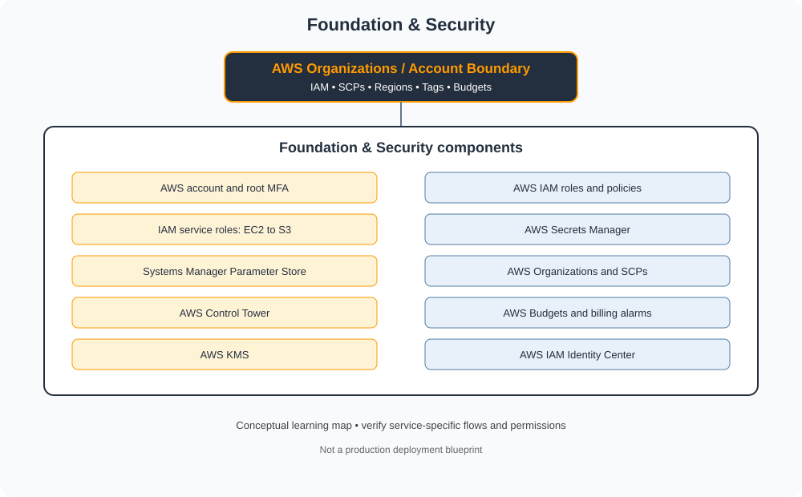

# Foundation & Security

> Category learning tracker for AWS Master Vault. Service names and examples in this folder are AWS-specific.

## Category architecture

- [Editable category diagram](architecture.drawio)
- [Mermaid source](architecture.mmd)
- [Full visual library](../../VISUAL-DIAGRAMS.md)
- [Master architecture](../../AWS-ENTERPRISE-REFERENCE-ARCHITECTURE.md)

## Component tracker

| Topic guide | SVG diagram | Editable draw.io |
|---|---|---|
| [AWS account and root MFA](../../services/aws-account-and-root-mfa.md) | [SVG](../../services/aws-account-and-root-mfa/architecture.svg) | [draw.io](../../services/aws-account-and-root-mfa/architecture.drawio) |
| [AWS IAM roles and policies](../../services/aws-iam-roles-and-policies.md) | [SVG](../../services/aws-iam-roles-and-policies/architecture.svg) | [draw.io](../../services/aws-iam-roles-and-policies/architecture.drawio) |
| [IAM service roles: EC2 to S3](../../services/iam-service-roles-ec2-to-s3.md) | [SVG](../../services/iam-service-roles-ec2-to-s3/architecture.svg) | [draw.io](../../services/iam-service-roles-ec2-to-s3/architecture.drawio) |
| [AWS Secrets Manager](../../services/aws-secrets-manager.md) | [SVG](../../services/aws-secrets-manager/architecture.svg) | [draw.io](../../services/aws-secrets-manager/architecture.drawio) |
| [Systems Manager Parameter Store](../../services/systems-manager-parameter-store.md) | [SVG](../../services/systems-manager-parameter-store/architecture.svg) | [draw.io](../../services/systems-manager-parameter-store/architecture.drawio) |
| [AWS Organizations and SCPs](../../services/aws-organizations-and-scps.md) | [SVG](../../services/aws-organizations-and-scps/architecture.svg) | [draw.io](../../services/aws-organizations-and-scps/architecture.drawio) |
| [AWS Control Tower](../../services/aws-control-tower.md) | [SVG](../../services/aws-control-tower/architecture.svg) | [draw.io](../../services/aws-control-tower/architecture.drawio) |
| [AWS Budgets and billing alarms](../../services/aws-budgets-and-billing-alarms.md) | [SVG](../../services/aws-budgets-and-billing-alarms/architecture.svg) | [draw.io](../../services/aws-budgets-and-billing-alarms/architecture.drawio) |
| [AWS KMS](../../services/aws-kms.md) | [SVG](../../services/aws-kms/architecture.svg) | [draw.io](../../services/aws-kms/architecture.drawio) |
| [AWS IAM Identity Center](../../services/aws-iam-identity-center.md) | [SVG](../../services/aws-iam-identity-center/architecture.svg) | [draw.io](../../services/aws-iam-identity-center/architecture.drawio) |

## Practice workflow
1. Read the official documentation for each selected service.
2. Map its account/project boundary, identity, network and data flows.
3. Complete a sandbox lab and capture validation evidence.
4. Test one denied-access or failure scenario.
5. Record cost, teardown proof and design trade-offs.

## Official references
- [AWS documentation](https://docs.aws.amazon.com/)
- [AWS Well-Architected Framework](https://docs.aws.amazon.com/wellarchitected/latest/framework/welcome.html)
- [AWS pricing](https://aws.amazon.com/pricing/)

> Diagram files are conceptual learning resources, not production-certified designs. Validate current service capabilities, permissions, routing, quotas, regional availability and prices before deployment.
