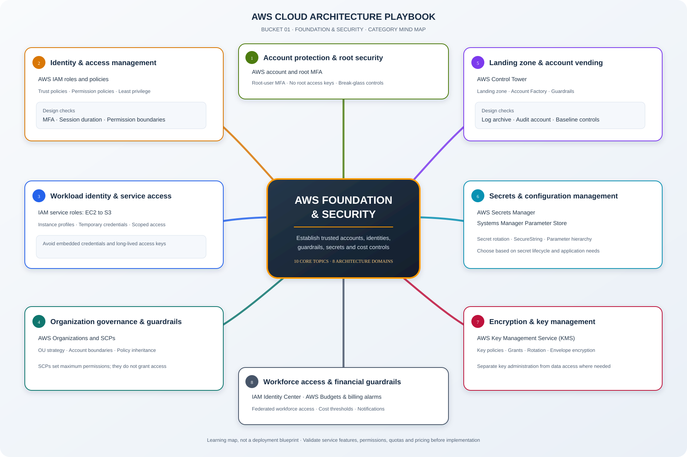

# Bucket 1 — Foundation & Security

> AWS Master Vault category study map. This category establishes the account, identity, governance, workload access, secrets, encryption and financial controls expected before workloads are deployed.

## Category mind map

The map follows the visual study-map standard: a central topic, eight numbered colour-coded branches, and three concise learning cards per branch. These are conceptual learning domains, not a mandatory deployment sequence.

## Eight learning domains

1. **Account security** — AWS account boundary, root-user MFA, recovery access and break-glass controls.
2. **Identity & access** — IAM roles and policies, trust policies, least privilege and permission boundaries.
3. **Workload IAM** — EC2 instance profiles, temporary credentials and service-to-service access.
4. **Secrets & keys** — Secrets Manager, Systems Manager Parameter Store and AWS KMS.
5. **Org governance** — AWS Organizations, organizational units, service control policies and account baselines.
6. **Landing zone** — AWS Control Tower, Account Factory and preventive/detective guardrails.
7. **Workforce IAM** — IAM Identity Center, federation, single sign-on and permission sets.
8. **FinOps guardrails** — AWS Budgets, billing alarms, cost allocation and visibility.

## Map source files

- [SVG mind map](architecture.svg)
- [Editable diagrams.net file](architecture.drawio)
- [Mermaid mind map source](architecture.mmd)

## Important architecture guardrails

- Protect the root user with MFA and do not create root access keys.
- Prefer roles and temporary credentials over long-lived access keys.
- IAM trust policies determine who can assume a role; permission policies determine what the role can do.
- Service control policies define the maximum permissions available in an organization. **They do not grant permissions.**
- KMS key policies are central to authorizing use of customer-managed keys.
- Secrets Manager and Systems Manager Parameter Store have overlapping but distinct lifecycle and configuration use cases.
- AWS Budgets and billing alarms provide alerts; they are **not hard spending caps**.

## Suggested study workflow

1. Read the eight branches and identify the controls relevant to your account model.
2. Open the linked service guides and work through the concepts and hands-on exercises.
3. Validate current AWS behaviour, quotas, pricing and service limits against official AWS documentation.
4. Apply controls in a sandbox before promoting them into shared or production accounts.
