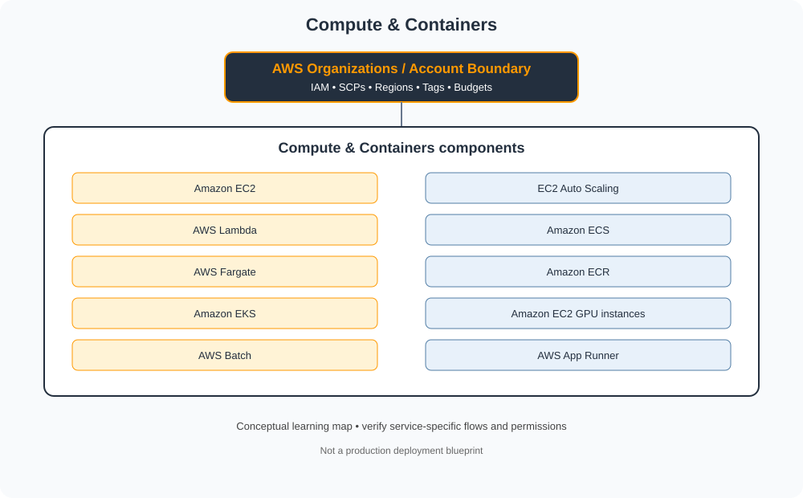

# 02-compute-containers

> AWS Master Vault category tracker. This folder uses AWS-specific service terminology and design patterns.

## Category architecture

- [Editable category diagram](architecture.drawio)
- [Mermaid source](architecture.mmd)
- [Full visual architecture library](../../VISUAL-DIAGRAMS.md)
- [Master reference architecture](../../AWS-ENTERPRISE-REFERENCE-ARCHITECTURE.md)

## Component tracker

| Topic guide | SVG diagram | Editable draw.io |
|---|---|---|

## Practice workflow
1. Read the official service documentation.
2. Map account/project boundaries, identity, network and data flows.
3. Complete a sandbox lab and capture validation evidence.
4. Test a denied-access or failure scenario.
5. Record cost, teardown proof and design trade-offs.

## Official references
- [AWS documentation](https://docs.aws.amazon.com/)
- [AWS Well-Architected Framework](https://docs.aws.amazon.com/wellarchitected/latest/framework/welcome.html)
- [AWS pricing](https://aws.amazon.com/pricing/)

> Diagrams are conceptual learning resources, not production-certified designs. Verify service capabilities, permissions, routing, quotas, regional availability and pricing before deployment.
