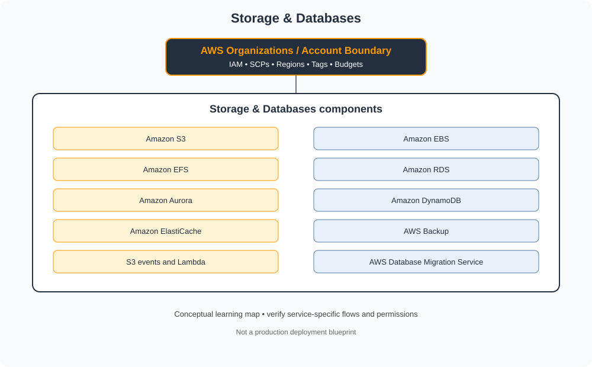

# Storage & Databases

> Category learning tracker for AWS Master Vault. Service names and examples in this folder are AWS-specific.

## Category architecture

- [Editable category diagram](architecture.drawio)
- [Mermaid source](architecture.mmd)
- [Full visual library](../../VISUAL-DIAGRAMS.md)
- [Master architecture](../../AWS-ENTERPRISE-REFERENCE-ARCHITECTURE.md)

## Component tracker

| Topic guide | SVG diagram | Editable draw.io |
|---|---|---|
| [Amazon S3](../../services/amazon-s3.md) | [SVG](../../services/amazon-s3/architecture.svg) | [draw.io](../../services/amazon-s3/architecture.drawio) |
| [Amazon EBS](../../services/amazon-ebs.md) | [SVG](../../services/amazon-ebs/architecture.svg) | [draw.io](../../services/amazon-ebs/architecture.drawio) |
| [Amazon EFS](../../services/amazon-efs.md) | [SVG](../../services/amazon-efs/architecture.svg) | [draw.io](../../services/amazon-efs/architecture.drawio) |
| [Amazon RDS](../../services/amazon-rds.md) | [SVG](../../services/amazon-rds/architecture.svg) | [draw.io](../../services/amazon-rds/architecture.drawio) |
| [Amazon Aurora](../../services/amazon-aurora.md) | [SVG](../../services/amazon-aurora/architecture.svg) | [draw.io](../../services/amazon-aurora/architecture.drawio) |
| [Amazon DynamoDB](../../services/amazon-dynamodb.md) | [SVG](../../services/amazon-dynamodb/architecture.svg) | [draw.io](../../services/amazon-dynamodb/architecture.drawio) |
| [Amazon ElastiCache](../../services/amazon-elasticache.md) | [SVG](../../services/amazon-elasticache/architecture.svg) | [draw.io](../../services/amazon-elasticache/architecture.drawio) |
| [AWS Backup](../../services/aws-backup.md) | [SVG](../../services/aws-backup/architecture.svg) | [draw.io](../../services/aws-backup/architecture.drawio) |
| [S3 events and Lambda](../../services/s3-events-and-lambda.md) | [SVG](../../services/s3-events-and-lambda/architecture.svg) | [draw.io](../../services/s3-events-and-lambda/architecture.drawio) |
| [AWS Database Migration Service](../../services/aws-database-migration-service.md) | [SVG](../../services/aws-database-migration-service/architecture.svg) | [draw.io](../../services/aws-database-migration-service/architecture.drawio) |

## Practice workflow
1. Read the official documentation for each selected service.
2. Map its account/project boundary, identity, network and data flows.
3. Complete a sandbox lab and capture validation evidence.
4. Test one denied-access or failure scenario.
5. Record cost, teardown proof and design trade-offs.

## Official references
- [AWS documentation](https://docs.aws.amazon.com/)
- [AWS Well-Architected Framework](https://docs.aws.amazon.com/wellarchitected/latest/framework/welcome.html)
- [AWS pricing](https://aws.amazon.com/pricing/)

> Diagram files are conceptual learning resources, not production-certified designs. Validate current service capabilities, permissions, routing, quotas, regional availability and prices before deployment.
