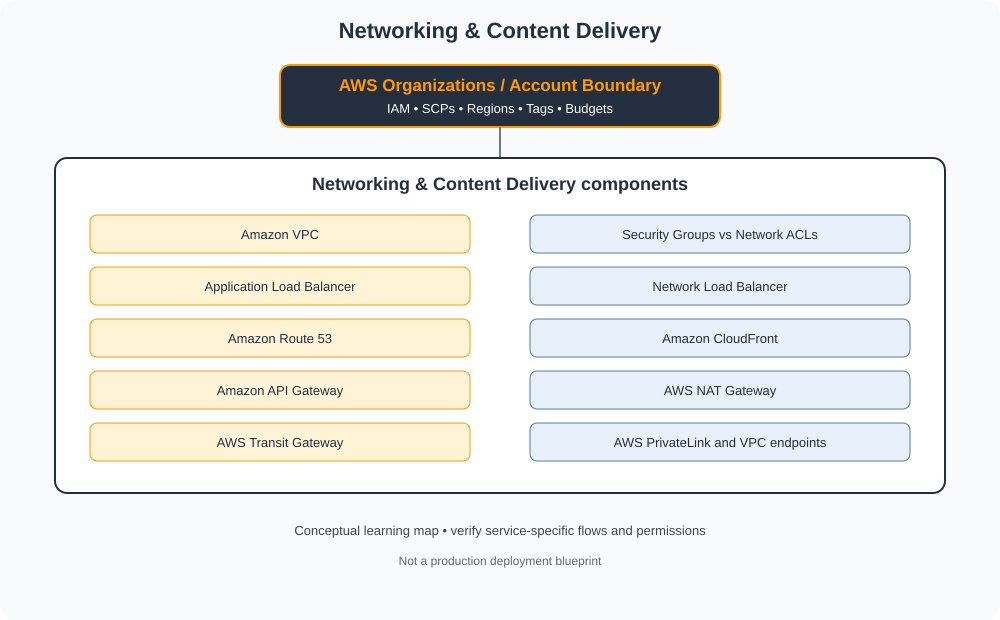

# Networking & Content Delivery

> Category learning tracker for AWS Master Vault. Service names and examples in this folder are AWS-specific.

## Category architecture

- [Editable category diagram](architecture.drawio)
- [Mermaid source](architecture.mmd)
- [Full visual library](../../VISUAL-DIAGRAMS.md)
- [Master architecture](../../AWS-ENTERPRISE-REFERENCE-ARCHITECTURE.md)

## Component tracker

| Topic guide | SVG diagram | Editable draw.io |
|---|---|---|
| [Amazon VPC](../../services/amazon-vpc.md) | [SVG](../../services/amazon-vpc/architecture.svg) | [draw.io](../../services/amazon-vpc/architecture.drawio) |
| [Security Groups vs Network ACLs](../../services/security-groups-vs-network-acls.md) | [SVG](../../services/security-groups-vs-network-acls/architecture.svg) | [draw.io](../../services/security-groups-vs-network-acls/architecture.drawio) |
| [Application Load Balancer](../../services/application-load-balancer.md) | [SVG](../../services/application-load-balancer/architecture.svg) | [draw.io](../../services/application-load-balancer/architecture.drawio) |
| [Network Load Balancer](../../services/network-load-balancer.md) | [SVG](../../services/network-load-balancer/architecture.svg) | [draw.io](../../services/network-load-balancer/architecture.drawio) |
| [Amazon Route 53](../../services/amazon-route-53.md) | [SVG](../../services/amazon-route-53/architecture.svg) | [draw.io](../../services/amazon-route-53/architecture.drawio) |
| [Amazon CloudFront](../../services/amazon-cloudfront.md) | [SVG](../../services/amazon-cloudfront/architecture.svg) | [draw.io](../../services/amazon-cloudfront/architecture.drawio) |
| [Amazon API Gateway](../../services/amazon-api-gateway.md) | [SVG](../../services/amazon-api-gateway/architecture.svg) | [draw.io](../../services/amazon-api-gateway/architecture.drawio) |
| [AWS NAT Gateway](../../services/aws-nat-gateway.md) | [SVG](../../services/aws-nat-gateway/architecture.svg) | [draw.io](../../services/aws-nat-gateway/architecture.drawio) |
| [AWS Transit Gateway](../../services/aws-transit-gateway.md) | [SVG](../../services/aws-transit-gateway/architecture.svg) | [draw.io](../../services/aws-transit-gateway/architecture.drawio) |
| [AWS PrivateLink and VPC endpoints](../../services/aws-privatelink-and-vpc-endpoints.md) | [SVG](../../services/aws-privatelink-and-vpc-endpoints/architecture.svg) | [draw.io](../../services/aws-privatelink-and-vpc-endpoints/architecture.drawio) |

## Practice workflow
1. Read the official documentation for each selected service.
2. Map its account/project boundary, identity, network and data flows.
3. Complete a sandbox lab and capture validation evidence.
4. Test one denied-access or failure scenario.
5. Record cost, teardown proof and design trade-offs.

## Official references
- [AWS documentation](https://docs.aws.amazon.com/)
- [AWS Well-Architected Framework](https://docs.aws.amazon.com/wellarchitected/latest/framework/welcome.html)
- [AWS pricing](https://aws.amazon.com/pricing/)

> Diagram files are conceptual learning resources, not production-certified designs. Validate current service capabilities, permissions, routing, quotas, regional availability and prices before deployment.
