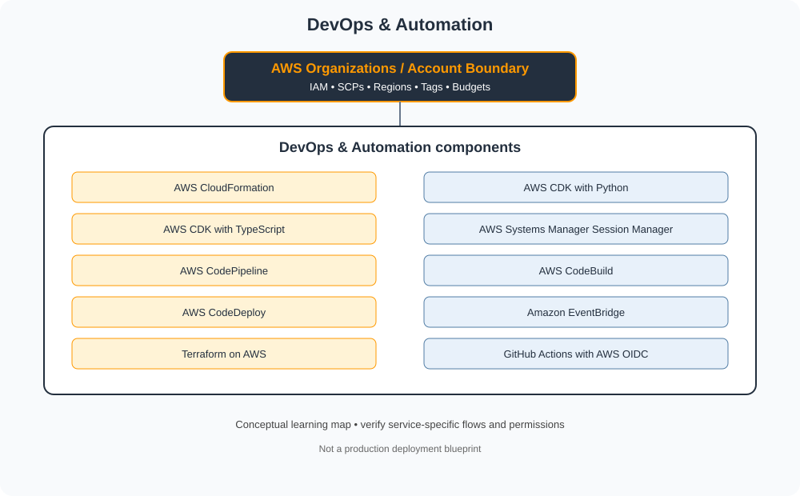

# Bucket 5 — DevOps & Automation

> AWS Master Vault learning tracker. This category uses AWS-native services, identity models, networking and governance terminology.

## Category architecture

- [Editable category diagram](architecture.drawio)
- [Mermaid source](architecture.mmd)
- [Visual architecture library](../../VISUAL-DIAGRAMS.md)
- [Enterprise reference architecture](../../AWS-ENTERPRISE-REFERENCE-ARCHITECTURE.md)

## Component checklist

| Topic | Learning guide | Diagram (SVG) | Editable diagram |
|---|---|---|---|
| AWS CloudFormation | [Open guide](../../services/aws-cloudformation.md) | [View](../../services/aws-cloudformation/architecture.svg) | [draw.io](../../services/aws-cloudformation/architecture.drawio) |
| AWS CDK with Python | [Open guide](../../services/aws-cdk-with-python.md) | [View](../../services/aws-cdk-with-python/architecture.svg) | [draw.io](../../services/aws-cdk-with-python/architecture.drawio) |
| AWS CDK with TypeScript | [Open guide](../../services/aws-cdk-with-typescript.md) | [View](../../services/aws-cdk-with-typescript/architecture.svg) | [draw.io](../../services/aws-cdk-with-typescript/architecture.drawio) |
| AWS Systems Manager Session Manager | [Open guide](../../services/aws-systems-manager-session-manager.md) | [View](../../services/aws-systems-manager-session-manager/architecture.svg) | [draw.io](../../services/aws-systems-manager-session-manager/architecture.drawio) |
| AWS CodePipeline | [Open guide](../../services/aws-codepipeline.md) | [View](../../services/aws-codepipeline/architecture.svg) | [draw.io](../../services/aws-codepipeline/architecture.drawio) |
| AWS CodeBuild | [Open guide](../../services/aws-codebuild.md) | [View](../../services/aws-codebuild/architecture.svg) | [draw.io](../../services/aws-codebuild/architecture.drawio) |
| AWS CodeDeploy | [Open guide](../../services/aws-codedeploy.md) | [View](../../services/aws-codedeploy/architecture.svg) | [draw.io](../../services/aws-codedeploy/architecture.drawio) |
| Amazon EventBridge | [Open guide](../../services/amazon-eventbridge.md) | [View](../../services/amazon-eventbridge/architecture.svg) | [draw.io](../../services/amazon-eventbridge/architecture.drawio) |
| Terraform on AWS | [Open guide](../../services/terraform-on-aws.md) | [View](../../services/terraform-on-aws/architecture.svg) | [draw.io](../../services/terraform-on-aws/architecture.drawio) |
| GitHub Actions with AWS OIDC | [Open guide](../../services/github-actions-with-aws-oidc.md) | [View](../../services/github-actions-with-aws-oidc/architecture.svg) | [draw.io](../../services/github-actions-with-aws-oidc/architecture.drawio) |

## Practice workflow
1. Read the official documentation and note service scope, limits and alternatives.
2. Map identity, network paths, data flows, dependencies and ownership.
3. Complete a sandbox lab and capture validation evidence.
4. Test an access-denied or failure scenario where safe.
5. Record monitoring, cost observations and teardown proof.

## Official references
- [AWS documentation](https://docs.aws.amazon.com/)
- [Architecture framework](https://docs.aws.amazon.com/wellarchitected/latest/framework/welcome.html)
- [Pricing](https://aws.amazon.com/pricing/)

> Diagrams are conceptual learning resources, not production-certified designs. Verify service capabilities, IAM permissions, network behavior, quotas, regional availability and pricing before deployment.
