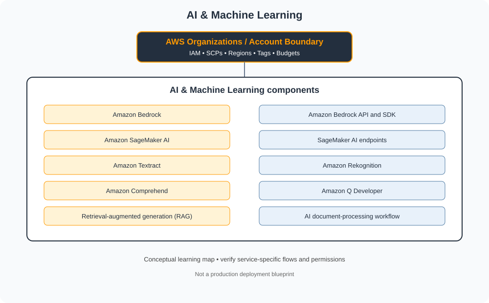

# AI & Machine Learning

> Category learning tracker for AWS Master Vault. Service names and examples in this folder are AWS-specific.

## Category architecture

- [Editable category diagram](architecture.drawio)
- [Mermaid source](architecture.mmd)
- [Full visual library](../../VISUAL-DIAGRAMS.md)
- [Master architecture](../../AWS-ENTERPRISE-REFERENCE-ARCHITECTURE.md)

## Component tracker

| Topic guide | SVG diagram | Editable draw.io |
|---|---|---|
| [Amazon Bedrock](../../services/amazon-bedrock.md) | [SVG](../../services/amazon-bedrock/architecture.svg) | [draw.io](../../services/amazon-bedrock/architecture.drawio) |
| [Amazon Bedrock API and SDK](../../services/amazon-bedrock-api-and-sdk.md) | [SVG](../../services/amazon-bedrock-api-and-sdk/architecture.svg) | [draw.io](../../services/amazon-bedrock-api-and-sdk/architecture.drawio) |
| [Amazon SageMaker AI](../../services/amazon-sagemaker-ai.md) | [SVG](../../services/amazon-sagemaker-ai/architecture.svg) | [draw.io](../../services/amazon-sagemaker-ai/architecture.drawio) |
| [SageMaker AI endpoints](../../services/sagemaker-ai-endpoints.md) | [SVG](../../services/sagemaker-ai-endpoints/architecture.svg) | [draw.io](../../services/sagemaker-ai-endpoints/architecture.drawio) |
| [Amazon Textract](../../services/amazon-textract.md) | [SVG](../../services/amazon-textract/architecture.svg) | [draw.io](../../services/amazon-textract/architecture.drawio) |
| [Amazon Rekognition](../../services/amazon-rekognition.md) | [SVG](../../services/amazon-rekognition/architecture.svg) | [draw.io](../../services/amazon-rekognition/architecture.drawio) |
| [Amazon Comprehend](../../services/amazon-comprehend.md) | [SVG](../../services/amazon-comprehend/architecture.svg) | [draw.io](../../services/amazon-comprehend/architecture.drawio) |
| [Amazon Q Developer](../../services/amazon-q-developer.md) | [SVG](../../services/amazon-q-developer/architecture.svg) | [draw.io](../../services/amazon-q-developer/architecture.drawio) |
| [Retrieval-augmented generation (RAG)](../../services/retrieval-augmented-generation-rag.md) | [SVG](../../services/retrieval-augmented-generation-rag/architecture.svg) | [draw.io](../../services/retrieval-augmented-generation-rag/architecture.drawio) |
| [AI document-processing workflow](../../services/ai-document-processing-workflow.md) | [SVG](../../services/ai-document-processing-workflow/architecture.svg) | [draw.io](../../services/ai-document-processing-workflow/architecture.drawio) |

## Practice workflow
1. Read the official documentation for each selected service.
2. Map its account/project boundary, identity, network and data flows.
3. Complete a sandbox lab and capture validation evidence.
4. Test one denied-access or failure scenario.
5. Record cost, teardown proof and design trade-offs.

## Official references
- [AWS documentation](https://docs.aws.amazon.com/)
- [AWS Well-Architected Framework](https://docs.aws.amazon.com/wellarchitected/latest/framework/welcome.html)
- [AWS pricing](https://aws.amazon.com/pricing/)

> Diagram files are conceptual learning resources, not production-certified designs. Validate current service capabilities, permissions, routing, quotas, regional availability and prices before deployment.
