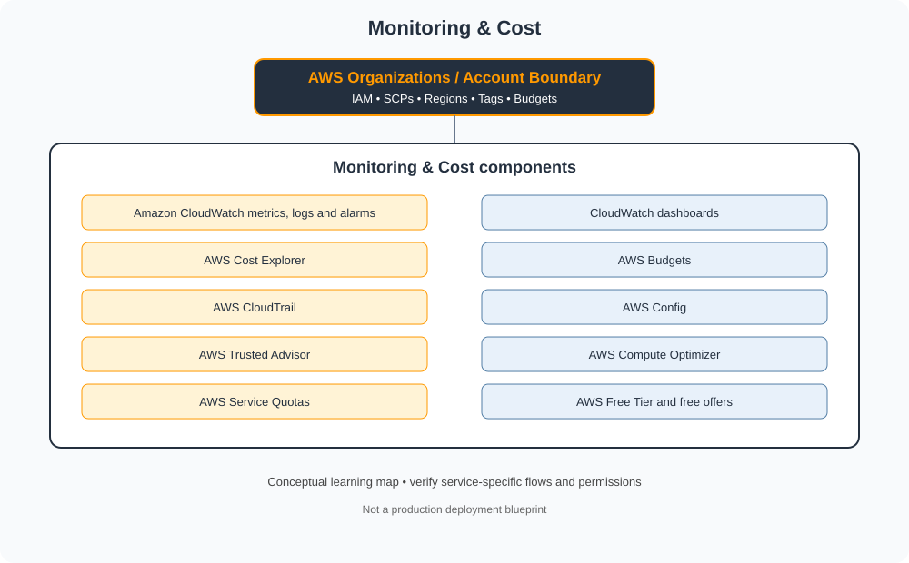

# Monitoring & Cost

> Category learning tracker for AWS Master Vault. Service names and examples in this folder are AWS-specific.

## Category architecture

- [Editable category diagram](architecture.drawio)
- [Mermaid source](architecture.mmd)
- [Full visual library](../../VISUAL-DIAGRAMS.md)
- [Master architecture](../../AWS-ENTERPRISE-REFERENCE-ARCHITECTURE.md)

## Component tracker

| Topic guide | SVG diagram | Editable draw.io |
|---|---|---|
| [Amazon CloudWatch metrics, logs and alarms](../../services/amazon-cloudwatch-metrics-logs-and-alarms.md) | [SVG](../../services/amazon-cloudwatch-metrics-logs-and-alarms/architecture.svg) | [draw.io](../../services/amazon-cloudwatch-metrics-logs-and-alarms/architecture.drawio) |
| [CloudWatch dashboards](../../services/cloudwatch-dashboards.md) | [SVG](../../services/cloudwatch-dashboards/architecture.svg) | [draw.io](../../services/cloudwatch-dashboards/architecture.drawio) |
| [AWS Cost Explorer](../../services/aws-cost-explorer.md) | [SVG](../../services/aws-cost-explorer/architecture.svg) | [draw.io](../../services/aws-cost-explorer/architecture.drawio) |
| [AWS Budgets](../../services/aws-budgets.md) | [SVG](../../services/aws-budgets/architecture.svg) | [draw.io](../../services/aws-budgets/architecture.drawio) |
| [AWS CloudTrail](../../services/aws-cloudtrail.md) | [SVG](../../services/aws-cloudtrail/architecture.svg) | [draw.io](../../services/aws-cloudtrail/architecture.drawio) |
| [AWS Config](../../services/aws-config.md) | [SVG](../../services/aws-config/architecture.svg) | [draw.io](../../services/aws-config/architecture.drawio) |
| [AWS Trusted Advisor](../../services/aws-trusted-advisor.md) | [SVG](../../services/aws-trusted-advisor/architecture.svg) | [draw.io](../../services/aws-trusted-advisor/architecture.drawio) |
| [AWS Compute Optimizer](../../services/aws-compute-optimizer.md) | [SVG](../../services/aws-compute-optimizer/architecture.svg) | [draw.io](../../services/aws-compute-optimizer/architecture.drawio) |
| [AWS Service Quotas](../../services/aws-service-quotas.md) | [SVG](../../services/aws-service-quotas/architecture.svg) | [draw.io](../../services/aws-service-quotas/architecture.drawio) |
| [AWS Free Tier and free offers](../../services/aws-free-tier-and-free-offers.md) | [SVG](../../services/aws-free-tier-and-free-offers/architecture.svg) | [draw.io](../../services/aws-free-tier-and-free-offers/architecture.drawio) |

## Practice workflow
1. Read the official documentation for each selected service.
2. Map its account/project boundary, identity, network and data flows.
3. Complete a sandbox lab and capture validation evidence.
4. Test one denied-access or failure scenario.
5. Record cost, teardown proof and design trade-offs.

## Official references
- [AWS documentation](https://docs.aws.amazon.com/)
- [AWS Well-Architected Framework](https://docs.aws.amazon.com/wellarchitected/latest/framework/welcome.html)
- [AWS pricing](https://aws.amazon.com/pricing/)

> Diagram files are conceptual learning resources, not production-certified designs. Validate current service capabilities, permissions, routing, quotas, regional availability and prices before deployment.
